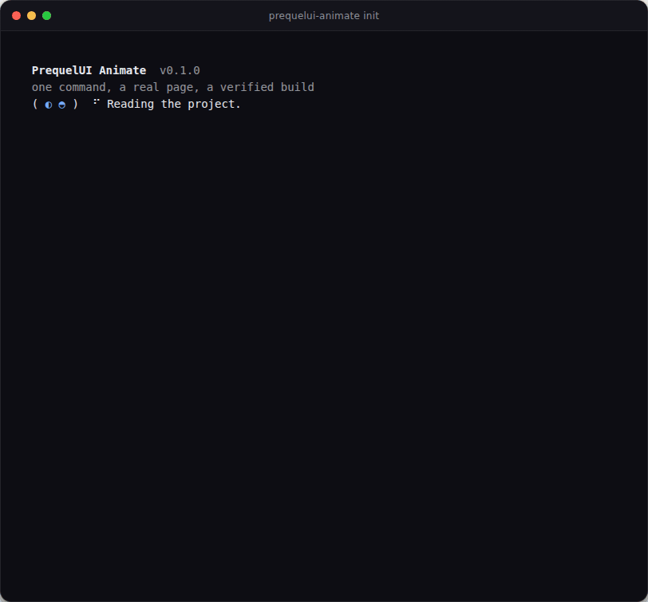

# prequelui-animate

One command to set up PrequelUI Animate in an existing project.

```bash
npx prequelui-animate init
```

The CLI reads the project, prints the exact plan, waits for a yes, then installs
the proven recipe, writes one example page and runs the build. It never deletes
a file and never changes a project without consent.

## Demo



A real run on a Vite + React project. The bot looks around while it reads, the
coloured plan names every command, a single `y` accepts it, each step gets a
check, and the green face ends on the address to open.

The recording is an asciinema v2 file ([`assets/prequelui-init.cast`](assets/prequelui-init.cast));
the stills are [`assets/prequelui-init-plan.png`](assets/prequelui-init-plan.png)
and [`assets/prequelui-init-done.png`](assets/prequelui-init-done.png).

## What it detects

| Signal | Values |
| --- | --- |
| Framework | Next.js App Router, Next.js Pages Router, Vite + React, Nuxt, Vite + Vue, SvelteKit, Vite + Svelte, SolidStart, Vite + Solid, Astro, Laravel + React, HTML / JavaScript |
| Package manager | `npm`, `pnpm`, `yarn`, `bun`, from the lockfile or `packageManager` |
| Language | TypeScript or JavaScript |
| Tailwind CSS | v3, v4 or none |
| Registry | `components.json` present or not |
| Layout | `src/` and the app directory |

When two frameworks match with the same confidence, it asks a single question
with the candidates. `--framework` and `--package-manager` override detection.

## Options

```text
-y, --yes               Accept the whole plan, no questions
    --dry-run           Print the plan and change nothing
    --framework <id>    Override detection
    --package-manager   Override the lockfile
-h, --help              Show help
-v, --version           Print the version
```

## What it writes

- the runtime dependencies (`motion` and the framework's Lucide package);
- `button`, `gradient-text` and `typing-text` from the PrequelUI Animate
  registry, with the shared motion helpers;
- a registry configuration when the project has none;
- one example page:
  - `/prequelui-demo` for Next.js, Nuxt, SvelteKit, SolidStart and Astro;
  - `/prequelui-demo.html` for Vite apps and plain HTML;
- the build, then the address to open.

The page shows the three components live, each with the code to copy beside it,
a link back to the components, docs and icon gallery, and the mascot in the
corner. One framework-free runtime drives it everywhere: the eyes follow the
pointer, the face breathes, blinks out of rhythm, turns happy on hover, shrinks
into a three-dot thinking face on click or Enter, and narrows its eyes when the
page reports an error. It is the same markup, CSS and script in React, Vue,
Svelte, Solid, Astro and plain HTML, and `prefers-reduced-motion` keeps the
face with no movement and no listeners. The HTML page keeps the framework-free
dialog and the same mascot. The page is yours: keep it, edit it or delete it.
The registry items stay as source files in the project.

## Safety

- The plan is printed before anything runs.
- One yes/no question, defaulting to no; `--yes` skips it.
- `--dry-run` writes nothing.
- Config files are only extended when the CLI can recognise the untouched
  template, or through the framework's own CLI (`sv add`, `shadcn init`).
- A failing step stops the run. No file is deleted.
- Running `init` again is safe: installed components, configuration and the
  example page are detected and left untouched. An example page you edited is
  never overwritten.
- Laravel and unknown projects switch to guided mode: the CLI prints the proven
  steps instead of editing the app.

## Proven targets

Every recipe is run in a disposable Docker container with the project's official
scaffold, the published registry copied locally, then the CLI end to end:
install, example page and production build.

| Target | Status |
| --- | --- |
| Next.js App Router | pass |
| Vite + React | pass |
| Nuxt | pass |
| Vite + Vue | pass |
| SvelteKit | pass |
| Vite + Svelte | pass |
| SolidStart | pass |
| Vite + Solid | pass |
| Astro | pass |
| HTML / JavaScript | pass |

Laravel is environment-specific (PHP + Composer) and stays guided. Results and
logs live in `analyse/init/` at the repository root.

## Development

```bash
npm run lint:init        # compile, 14 detection cases, 15 plan cases, 8 bot cases, 48 mascot checks, 16 CLI checks
npm run lint:init:refresh-demos   # rewrite the example page in every proven local target and rebuild it
npm run lint:init:captures:refresh # refresh the Vite React example and capture its mascot states
npm run lint:init:bac-next
npm run lint:init:bac-vite
npm run lint:init:bac-nuxt
npm run lint:init:bac-vite-vue
npm run lint:init:bac-sveltekit
npm run lint:init:bac-vite-svelte
npm run lint:init:bac-solid-start
npm run lint:init:bac-vite-solid
npm run lint:init:bac-astro
npm run lint:init:bac-html
npm run lint:init:bac-idem-vite    # runs init twice, compares every output hash
npm run lint:init:bac-idem-svelte
```

The terminal demo is recorded from a real run, not replayed by hand:

```bash
npm run lint:init:demo       # records assets/prequelui-init.cast
npm run lint:init:demo-gif   # renders the GIF and the two stills from the cast
```

It copies a proven Vite + React project to `/tmp/prequelui-init-demo`, removes
the example page so the write step really happens, and records the CLI under a
pseudo-terminal, so the colours and the bot animation are the ones a person
sees.

The CLI has no runtime dependency. It compiles with the TypeScript already
present in `web/node_modules`; nothing is published by the test suite.

## Licence

MIT.
